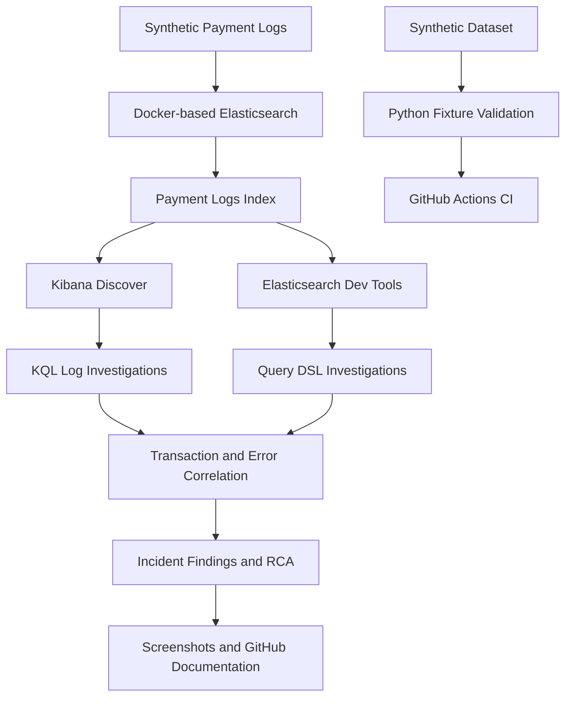

# Kibana Production Log Troubleshooting & Incident RCA Lab

[](https://github.com/praveenkoppad916-hue/kibana-production-log-troubleshooting/actions/workflows/validate.yml)

A **reproducible, fictional fintech log investigation lab** for L2/L3 production support. Explore 15 synthetic payment application log events, six Kibana KQL investigations, six Elasticsearch Query DSL examples, and an evidence-based incident RCA.

> **No employer logs, customer records, internal endpoints, credentials, or proprietary configurations are included.** This is an independent training project.

## Quick verification (no Elasticsearch installation)

Requires Python 3.9+ (standard library only):

```bash
python scripts/validate_examples.py
python -m unittest discover -s tests -v
```

Expected: `PASS: 15 fixture documents, all 8 scenario assertions, and 6 valid query JSON files` and four passing unit tests. GitHub Actions runs both commands on every push/PR.

**Scope:** These checks validate the sample data and expected counts, **not live Elasticsearch query execution**. See optional live setup below for end-to-end verification.

## Investigations

| Lab | Incident | KQL filter | Expected hits |
|---|---|---|---:|
| LOG-001 | Failed payment | `transaction_id: "TXN-100245"` | 4 |
| LOG-002 | Upstream timeout | `http.response.status_code: 504` | 2 |
| LOG-003 | Authentication/authorization | `http.response.status_code: (401 or 403)` | 2 |
| LOG-004 | HTTP 5xx failures | `http.response.status_code >= 500 and http.response.status_code < 600` | 7 |
| LOG-005 | Cross-service trace | `trace.id: "TRACE-A1"` | 4 |
| LOG-006 | Gateway error burst | `service.name: "api-gateway" and log.level: "ERROR" and http.response.status_code: 500` | 3 |

**Detailed walkthroughs and RCA:** [docs/incident-investigations.md](docs/incident-investigations.md)

## Optional: run queries against Elasticsearch + Kibana

Use a compatible Elasticsearch and Kibana installation. In **Kibana → Dev Tools → Console**, execute these requests in order:

1. Create the index with the JSON body from [`scripts/create_index.json`](scripts/create_index.json):

   `PUT payment-logs`

   Paste the mapping JSON beneath that line, then run the request.

2. Load the 15 documents using Elasticsearch Bulk API. The NDJSON fixture is **not already bulk formatted**; convert it with the standard-library command below from your repository root:

   ```bash
   python -c "import json,pathlib; rows=[json.loads(x) for x in pathlib.Path('data/payment_logs.ndjson').read_text().splitlines()]; pathlib.Path('data/bulk-import.ndjson').write_text(''.join(json.dumps({'index':{}})+'\n'+json.dumps(r)+'\n' for r in rows))"
   ```

   Then import using a local terminal with a configured, authorized Elasticsearch endpoint and credentials (example for a locally running unauthenticated test cluster only):

   ```bash
   curl -H 'Content-Type: application/x-ndjson' -X POST 'http://localhost:9200/payment-logs/_bulk?refresh=true' --data-binary @data/bulk-import.ndjson
   ```

   Check that the bulk response has `"errors":false`; use `GET payment-logs/_count` to confirm `15` documents. **Never upload `bulk-import.ndjson` if it contains real data.**

3. In Kibana, create a data view named `payment-logs` with index pattern `payment-logs` and time field `@timestamp`.
4. In Discover, set the **absolute UTC time range** to **2026-09-15 09:55 through 10:15**, and choose **KQL** (not Lucene).
5. Copy **one KQL query at a time** from [`queries/kql/investigations.kql`](queries/kql/investigations.kql). Compare hit counts with the table above.
6. In Dev Tools Console, run `GET payment-logs/_search` with the body from any JSON file in [`queries/elasticsearch/`](queries/elasticsearch/).

**Mapping matters:** The supplied explicit mapping uses `keyword` fields for exact matches (`transaction_id`, `trace.id`, `service.name`, `log.level`) and `integer` for HTTP status. Loading into an index with different mappings may produce zero results or different behavior.

**Security note:** For a real environment, follow your organization's TLS, authentication, and data-handling rules. The local HTTP example is for a throwaway development cluster only.

## Repository structure

```text
data/payment_logs.ndjson              15 fictional application events
queries/kql/investigations.kql        Copy/paste Kibana Discover filters
queries/elasticsearch/*.json          Elasticsearch Query DSL requests
scripts/create_index.json             Explicit field mappings
scripts/validate_examples.py          Offline fixture verification
tests/test_fixtures.py                Standard-library unit tests
docs/incident-investigations.md       Six labs and sample RCA
.github/workflows/validate.yml        CI validation
```
## System Architecture



### Architecture Explanation

This project demonstrates a reproducible production-support troubleshooting workflow using Docker, Elasticsearch, and Kibana.

1. **Log ingestion:** Synthetic fintech payment logs are imported into Elasticsearch.
2. **Log investigation:** Kibana Discover and Elasticsearch Dev Tools are used to search application logs with KQL and Query DSL.
3. **Incident analysis:** Transaction IDs, trace IDs, HTTP response codes, and application errors are correlated to investigate payment failures and service issues.
4. **RCA documentation:** Investigation findings are documented with supporting screenshots and incident reports.
5. **Automated validation:** Python tests and GitHub Actions independently verify the synthetic dataset and expected investigation results.

### Interview-Ready Project Explanation

"I developed a hands-on Kibana and Elasticsearch production troubleshooting lab using Docker and synthetic fintech payment logs.

I imported application logs into Elasticsearch and investigated payment failures, HTTP 500 errors, upstream timeouts, and authentication issues using Kibana KQL and Elasticsearch Query DSL.

For example, I traced transaction `TXN-100245` and verified four matching log events. I also documented incident findings, prepared RCA reports, and configured GitHub Actions to validate the sample investigation data.

This project demonstrates my approach to production incident investigation, log correlation, and evidence-based troubleshooting."

**Validation note:** Live Kibana investigations were performed locally. GitHub Actions validates the sample data and tests, not live Elasticsearch query execution.

## Hands-on Docker, Elasticsearch & Kibana Lab

Alongside the original synthetic-data investigation project, I created
a local Docker-based Elasticsearch and Kibana environment to practice
realistic L2/L3 production support troubleshooting.

### Lab Environment

- Docker Compose for local service orchestration
- Elasticsearch for application log indexing and searching
- Kibana Discover for log investigations
- Kibana Dev Tools for Elasticsearch Query DSL
- Synthetic fintech payment transaction logs
- Incident investigation documentation and RCA
- Screenshots documenting the investigation process

### Hands-on Investigations

The Docker lab includes six additional investigations:

| Lab | Investigation | KQL Filter | Observed Hits |
|---|---|---|---:|
| LOG-001 | Payment failure | `transaction_id: "TXN-100245"` | 4 |
| LOG-002 | Upstream timeout | `http.response.status_code: 504` | 2 |
| LOG-003 | Authentication and authorization | `http.response.status_code: (401 or 403)` | 2 |
| LOG-004 | High response latency | `event.duration_ms >= 1000` | 4 |
| LOG-005 | Application errors | `log.level: "ERROR"` | 7 |
| LOG-006 | HTTP 500 internal server errors | `http.response.status_code: 500` | 3 |

These investigations are separate from the six original offline
fixture scenarios documented earlier in this README.

### Investigation Methodology

1. Open Kibana Discover and select the payment log data view.
2. Set the appropriate absolute time range.
3. Filter application logs using KQL.
4. Investigate transaction IDs, HTTP status codes, and error messages.
5. Correlate events across application services.
6. Analyze response latency and application failures.
7. Record evidence and document incident findings.
8. Prepare an evidence-based incident RCA.

### Docker Lab Documentation

- [Docker Lab README](README-docker-lab.md)
- [KQL Investigation Notes](queries/kql-investigations.md)
- [Query DSL Examples](queries/)
- [Incident RCA](docs/INCIDENT-RCA-001.md)
- [Kibana Screenshots](screenshots/)

### Skills Demonstrated

- L2/L3 Application Production Support
- Elasticsearch and Kibana
- Docker Compose
- KQL and Elasticsearch Query DSL
- Application Log Analysis
- Payment Transaction Troubleshooting
- HTTP 4xx/5xx Error Investigation
- Incident Management
- Root Cause Analysis
- Technical Documentation

### Validation Scope

The original GitHub Actions workflow validates synthetic fixture data,
scenario assertions, JSON syntax, and unit tests.

The separate Docker lab includes hands-on Kibana Discover investigations
with saved screenshots. These screenshots demonstrate the observed
results but do not replace automated live Elasticsearch integration tests.

All data used in this project is fictional and intended for learning.

## What I learned / interview talking points

- KQL filters data in Kibana Discover; Query DSL powers Elasticsearch `_search` requests.
- Exact-match fields must be mapped appropriately to avoid false zero-hit investigations.
- Time range and selected data view are common reasons Discover displays no results.
- A transaction ID links a payment's lifecycle; a trace ID correlates events across services.
- Logs support evidence-based **observations**; deeper root-cause claims need additional evidence.


**Limitations:** The original sample investigations are validated
automatically using Python and GitHub Actions. A separate local
Docker-based Elasticsearch and Kibana lab was successfully tested
through Kibana Discover and Elasticsearch Dev Tools.

Six investigation screenshots and incident RCA documentation are
included in this repository.

Live Elasticsearch integration tests are not currently part of the
GitHub Actions workflow. Kibana dashboards have not been included.

All application logs and transaction records are synthetic.

